<!-- 

  <h1>Hi, I'm Hardhik Atchakala </h1>
  

    B.S. Computer Science & B.A. Data Science (Statistics Track) @ Rutgers University - New Brunswick Honors College
  

  
<em>I am passionate about crafting elegant solutions in code, with a focus on web technologies and AI. I love building scalable applications, working with data, and exploring machine learning.</em>

   

  

    
    
    
  

## My Skills

  
  
  
  
  
    
  
  
  
  
    
  
  
  
  
  

  
 Open to collaborations, projects, and exciting opportunities! Let's connect. 

 -->

<!-- Paste this file into the README.md of your public GitHub profile repository. -->

  

  

    <b>Rutgers University–New Brunswick Honors College</b> 
    B.S. Computer Science &amp; B.A. Data Science (Statistics Track)
  

  
Welcome to my GitHub page! I build useful things, follow my curiosity, and learn along the way.

  

    
    &nbsp;
    
    &nbsp;
    
  

---

### A little about me

I like turning “what if?” into something people can use. I build across the stack and enjoy figuring out how interfaces, backend systems, and data fit together.

Lately, my curiosity has been taking me toward **distributed systems, computer vision, AI agents, and machine learning**.

### Selected work

<table>
  <tr>
    <td width="50%" valign="top">
      
<strong>🌐 Grove</strong>

      
Connecting pantry and Census data to uncover gaps in food assistance.

      
🏆 2nd place · Morgan Stanley Code to Give

    </td>
    <td width="50%" valign="top">
      
<strong>⚡ Task-Gated Unlock</strong>

      
Connecting task completion to app access for more intentional focus on macOS.

      
Electron · React · FastAPI

    </td>
  </tr>
  <tr>
    <td width="50%" valign="top">
      
<strong>🛠️ Test Case Aggregation</strong>

      
Turning messy SharePoint exports into organized test case data at T-Mobile.

      
Next.js · Python · PostgreSQL

    </td>
    <td width="50%" valign="top">
      
<strong>🧠 NLP Research</strong>

      
Testing whether sign-related language patterns transfer between horoscope publishers.

      
Machine learning · Rutgers Honors Project

    </td>
  </tr>
</table>

<a href="https://hardhik.dev/">Explore more of my work ↗</a>

---

  <h3>Tools I build with</h3>

  

    <b>LANGUAGES</b> 
    
  

  

    <b>FRAMEWORKS</b> 
    
  

  

    <b>DATA &amp; INFRASTRUCTURE</b> 
    
  

  <h3>One contribution at a time</h3>

  <picture>
    <source media="(prefers-color-scheme: dark)" srcset="https://raw.githubusercontent.com/hatchakala/hatchakala/output/github-snake-dark.svg" />
    <source media="(prefers-color-scheme: light)" srcset="https://raw.githubusercontent.com/hatchakala/hatchakala/output/github-snake.svg" />
    
  </picture>

  

    <b>Have an idea or a project in mind?</b> 
    I'd love to hear about it. <a href="mailto:ha636@scarletmail.rutgers.edu">Let's talk ↗</a>
  

